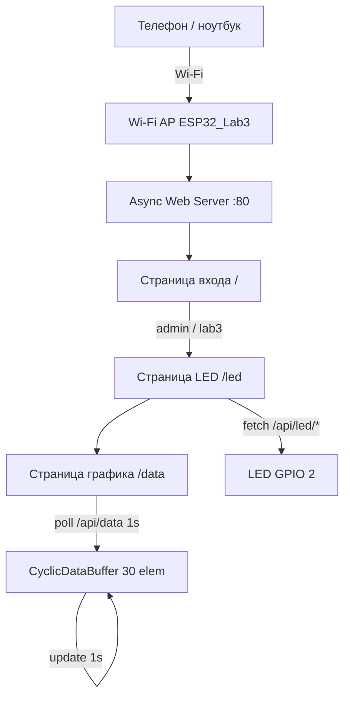

# Гайд: подключение и отладка (ESP32 + Wi-Fi AP + Web-сервер)

Лабораторная работа 3: ESP32 как точка доступа Wi-Fi с асинхронным web-сервером — вход, управление светодиодом и график циклического буфера.

---

## 1. Что понадобится

| Компонент | Примечание |
|-----------|------------|
| ESP32 (DevKit и т.п.) | Встроенный Wi-Fi, штатный LED на **GPIO 2** |
| USB-кабель | Питание и прошивка |
| Смартфон или ноутбук | Подключение к Wi-Fi AP и браузер |

Дополнительные датчики и провода **не нужны** — только плата ESP32.

**Библиотеки (обязательно):**

| Библиотека | Назначение |
|------------|------------|
| [ESPAsyncWebServer](https://github.com/mathieucarbou/ESPAsyncWebServer) | Асинхронный HTTP-сервер |
| [AsyncTCP](https://github.com/mathieucarbou/AsyncTCP) | TCP-стек для ESP32 (зависимость сервера) |

**Установка в Arduino IDE:**

1. *Sketch* → *Include Library* → *Manage Libraries*
2. Найти **AsyncTCP** (автор *mathieucarbou* или *me-no-dev*) → *Install*
3. Найти **ESPAsyncWebServer** → *Install*

> Если в Library Manager нет нужной версии — установите вручную через *Add .ZIP Library* с GitHub (сначала AsyncTCP, затем ESPAsyncWebServer).

---

## 2. Режим работы `USE_HARDWARE`

В файле `config.h`:

```cpp
#define USE_HARDWARE 0   // LED только в Serial Monitor (логика web работает)
#define USE_HARDWARE 1   // управление штатным LED на GPIO 2
```

| Режим | Когда использовать |
|-------|-------------------|
| `USE_HARDWARE 0` | Отладка web-части: состояние LED выводится в Serial |
| `USE_HARDWARE 1` | Сдача лабораторной: реальный светодиод на D2 |

Wi-Fi и web-сервер работают **в обоих режимах** (нужна прошитая ESP32).

---

## 3. Web-интерфейс и маршруты

### Страницы

| Страница | URL | Доступ |
|----------|-----|--------|
| Аутентификация | `http://192.168.4.1/` | Все |
| Управление LED | `http://192.168.4.1/led` | После входа |
| Мониторинг данных | `http://192.168.4.1/data` | После входа |

### Учётные данные по умолчанию

| Параметр | Значение |
|----------|----------|
| Wi-Fi SSID | `ESP32_Lab3` |
| Wi-Fi пароль | `12345678` |
| IP сервера | `192.168.4.1` (стандарт для AP ESP32) |
| Логин web | `admin` |
| Пароль web | `lab3` |

### API (JSON, без перезагрузки страницы)

| Метод | URL | Ответ / действие |
|-------|-----|------------------|
| POST | `/login` | Форма: `username`, `password` → редирект на `/led` или ошибка |
| GET | `/api/led/state` | `{"on":true}` или `{"on":false}` |
| POST | `/api/led/on` | Включить LED |
| POST | `/api/led/off` | Выключить LED |
| GET | `/api/data` | `{"values":[20.1,21.3,...]}` — 30 значений буфера |

Без авторизации запросы к `/led`, `/data` и `/api/*` перенаправляются на страницу входа.

### Схема работы (Mermaid)



---

## 4. Подключение (только ESP32)

```
    [ ПК ] ──USB──► [ ESP32 DevKit ]
                         │
                         └── GPIO 2 — штатный LED (D2, на плате)
```

1. Подключите ESP32 к компьютеру по USB.
2. Прошейте скетч `lab_3.ino`.
3. На телефоне/ПК: Wi-Fi → сеть **`ESP32_Lab3`**, пароль **`12345678`**.
4. Браузер → **http://192.168.4.1**
5. Войдите: **admin** / **lab3**.

> Пока вы подключены к AP ESP32, интернет через обычный Wi-Fi может быть недоступен — это нормально.

---

## 5. Что менять в `config.h`

| Параметр | По умолчанию | Когда менять |
|----------|--------------|--------------|
| `USE_HARDWARE` | `1` | `0` — отладка LED через Serial |
| `AP_SSID` | `ESP32_Lab3` | Имя своей точки доступа |
| `AP_PASSWORD` | `12345678` | Пароль AP (минимум **8** символов для WPA2) |
| `AUTH_LOGIN` | `admin` | Логин web-формы |
| `AUTH_PASSWORD` | `lab3` | Пароль web-формы |
| `LED_PIN` | `2` | Если LED на другом пине (обычно не менять) |
| `LED_ACTIVE_LOW` | `true` | `false`, если LED загорается от HIGH |
| `DATA_BUFFER_SIZE` | `30` | По ТЗ — 30, менять не нужно |
| `DATA_UPDATE_INTERVAL_MS` | `1000` | Интервал обновления буфера (1 с) |

---

## 6. Команды для запуска

### Переход в папку проекта (PowerShell)

```powershell
cd d:\Internet_of_Items\lab_3
```

Из соседней папки:

```powershell
cd d:\Internet_of_Items
cd .\lab_3
```

### Arduino IDE (основной способ)

| Действие | Как |
|----------|-----|
| Открыть проект | *File* → *Open* → `lab_3.ino` |
| Проверить компиляцию | **Verify** (`Ctrl+R`) |
| Прошить плату | **Upload** (`Ctrl+U`) |
| Serial Monitor | `Ctrl+Shift+M`, скорость **115200** |

Настройки *Tools*:

| Параметр | Рекомендация |
|----------|--------------|
| Board | **ESP32 Dev Module** |
| Port | Ваш COM-порт |
| Partition Scheme | *Default* или *Huge APP* (если не влезает прошивка) |

### arduino-cli (терминал, опционально)

**Один раз — ядро ESP32:**

```powershell
cd d:\Internet_of_Items\lab_3

arduino-cli core update-index
arduino-cli core install esp32:esp32
```

> Библиотеки ESPAsyncWebServer и AsyncTCP удобнее ставить через Arduino IDE (*Manage Libraries*). Для arduino-cli:

```powershell
arduino-cli lib install "ESPAsyncWebServer"
arduino-cli lib install "AsyncTCP"
```

**Компиляция, прошивка, монитор:**

```powershell
cd d:\Internet_of_Items\lab_3

arduino-cli board list
arduino-cli compile --fqbn esp32:esp32:esp32 .
arduino-cli upload -p COM3 --fqbn esp32:esp32:esp32 .
arduino-cli monitor -p COM3 -c baudrate=115200
```

Замените `COM3` на свой порт.

### Быстрая проверка после прошивки

```text
1. Serial Monitor 115200  →  «Lab 3 готов», IP, логин/пароль
2. Wi-Fi  →  подключиться к ESP32_Lab3 / 12345678
3. Браузер  →  http://192.168.4.1
4. Ввести admin / lab3  →  открывается /led
5. «Включить» / «Выключить»  →  LED на плате + обновление статуса
6. Перейти «Мониторинг»  →  график обновляется каждую секунду без F5
7. Неверный пароль  →  сообщение об ошибке, LED-страница недоступна
```

---

## 7. Пошаговая прошивка

### Шаг 1 — подготовка

1. Установите поддержку ESP32 в Board Manager.
2. Установите **AsyncTCP** и **ESPAsyncWebServer**.
3. Проверьте `config.h` (SSID, пароли, `USE_HARDWARE`).

### Шаг 2 — загрузка

1. Откройте `lab_3.ino`, выберите плату и COM-порт.
2. **Upload**, дождитесь «Done uploading».
3. Нажмите **EN/RST** на плате, если AP не появилась.

### Шаг 3 — проверка Serial

В мониторе должно появиться:

```text
=== Lab 3 готов ===
Wi-Fi AP: ESP32_Lab3
Пароль AP: 12345678
IP сервера: http://192.168.4.1
Логин: admin / Пароль: lab3
```

### Шаг 4 — проверка web

1. Страница входа — поля логин/пароль, кнопка «Войти».
2. После входа — две кнопки LED и лейбл «Состояние: …».
3. Страница «Мониторинг» — линейный график, точки сдвигаются каждую секунду (буфер 30 значений).

---

## 8. Отладка: типичные проблемы

### Не компилируется `ESPAsyncWebServer.h` / `AsyncTCP.h`

| Действие |
|----------|
| Установите **AsyncTCP** до ESPAsyncWebServer |
| Плата — **ESP32**, не Uno / ESP8266 |
| Обновите ESP32 core до актуальной версии |
| Используйте форк *mathieucarbou* — совместим с новыми версиями core |

### Wi-Fi сеть `ESP32_Lab3` не видна

| Проверка | Действие |
|----------|----------|
| Прошивка | Upload без ошибок |
| Serial | Есть «Lab 3 готов» |
| Перезагрузка | Кнопка EN/RST |
| Пароль AP | Не короче 8 символов |
| Антенна | ESP32 с металлическим экраном Wi-Fi (не голый чип без антенны) |

### Страница не открывается (192.168.4.1)

- Убедитесь, что подключены именно к **ESP32_Lab3**, а не к домашнему роутеру.
- Попробуйте `http://192.168.4.1/` (не https).
- Отключите VPN и «умную» маршрутизацию на телефоне.

### Вход не принимает логин/пароль

- Проверьте `AUTH_LOGIN` и `AUTH_PASSWORD` в `config.h`.
- По умолчанию: **admin** / **lab3** (без пробелов).
- Очистите cookie сайта или откройте вкладку в режиме инкognito.

### LED не загорается / наоборот

| Проверка | Действие |
|----------|----------|
| `USE_HARDWARE` | Должно быть `1` |
| Пин | `LED_PIN = 2` (D2) |
| Полярность | Переключите `LED_ACTIVE_LOW`: `true` ↔ `false` |
| Web | Статус на странице меняется? Если да — проблема в GPIO, не в сервере |

### График пустой или не обновляется

- Подождите до **30 секунд** — буфер заполняется постепенно.
- Откройте DevTools (F12) → Network → запросы `/api/data` каждую секунду.
- Не закрывайте вкладку «Мониторинг» — обновление через JavaScript, без F5.

### `#include <Arduino.h>` подчёркнут красным в Cursor

- Это IntelliSense редактора, не ошибка кода. Ориентируйтесь на компиляцию в Arduino IDE.

### Плата перезагружается в цикле

- Уменьшите нагрузку: другой Partition Scheme.
- Проверьте USB-кабель и порт.

---

## 9. Быстрый чеклист перед сдачей

- [ ] ESP32 поднимает Wi-Fi AP (`ESP32_Lab3`)
- [ ] Асинхронный web-сервер на порту 80
- [ ] Страница входа: логин, пароль, кнопка отправки
- [ ] LED-страница только после корректного входа
- [ ] Две кнопки вкл/выкл + лейбл состояния, GPIO 2
- [ ] Страница мониторинга: график 30 значений, обновление каждую 1 с без перезагрузки
- [ ] Классы разделены: AP, сервер, LED, буфер
- [ ] В `loop` вызывается обновление объектов

---

## 10. Структура проекта (для отчёта)

```
lab_3/
├── lab_3.ino                  — setup / loop
├── config.h                   — Wi-Fi, auth, LED, буфер
├── WiFiAccessPoint.h / .cpp   — точка доступа Wi-Fi
├── WebServerApp.h / .cpp      — async-сервер, сессии, API
├── LedController.h / .cpp     — светодиод D2
├── CyclicDataBuffer.h / .cpp  — кольцевой буфер 30 элементов
├── WebPages.h                 — HTML страниц
└── GUIDE.md                   — этот файл
```

### Роли классов

| Класс | Ответственность |
|-------|-----------------|
| `WiFiAccessPoint` | Режим AP, SSID/пароль, IP, число клиентов |
| `WebServerApp` | Маршруты, аутентификация, cookie-сессия, API |
| `LedController` | GPIO 2, текущее/предыдущее состояние, on/off |
| `CyclicDataBuffer` | Массив 30 float, push каждую секунду, JSON для графика |

**Логика в `loop`:**

- `dataBuffer.update()` — новое значение раз в секунду, старое вытесняется
- `led.update()` — фиксация смены состояния
- `accessPoint.update()` / `webApp.update()` — актуальность состояния модулей

Страница графика опрашивает `/api/data` через `fetch` + `setInterval(1000)` — перезагрузка браузера не требуется.
